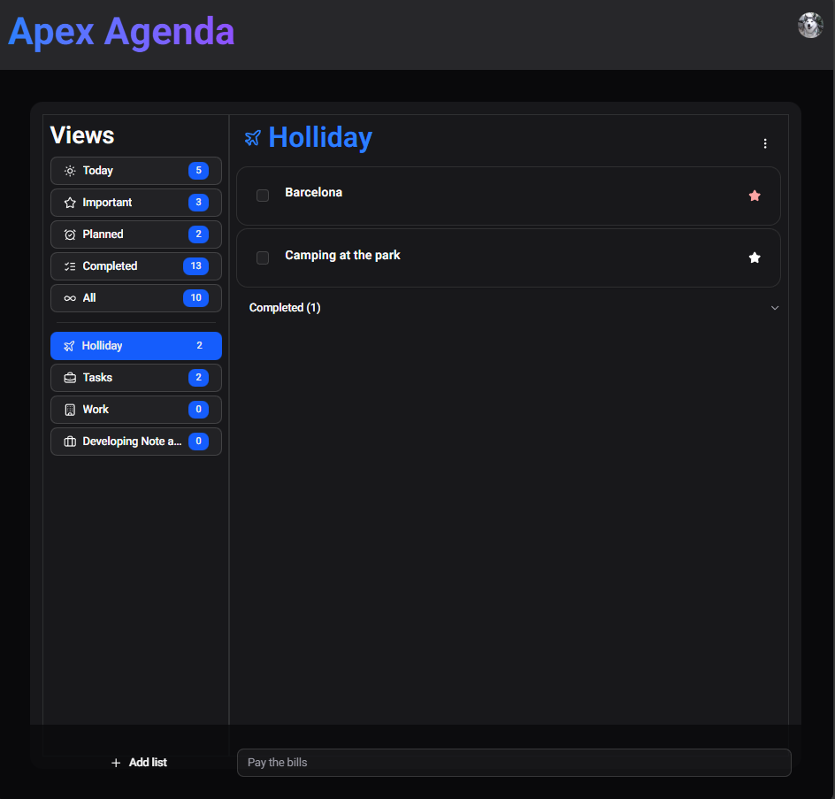

# Apex Agenda 🚀

**Stop managing your time. Start mastering it.**


_(Replace this text with your actual screenshot path, e.g., /public/dashboard.png)_

## 📖 About

Apex Agenda is a robust, full-stack task management application designed to handle complex scheduling needs. Unlike simple to-do lists, it handles timezone logic, category orchestration, and data prioritization to ensure you never miss a deadline.

## 🌟 Key Features

- **Smart Categorization:** Dynamic lists allow you to create custom categories or stick to the defaults (Today, Important, Planned).
- **Timezone-Aware "My Day":** Automatically detects tasks due on the current date and moves them to the "Today" view, handling server/client time mismatches.
- **Focus Mode:** "Completed" tasks are semi-hidden in a collapsible accordion to reduce visual clutter.
- **Secure Authentication:** Full login support via Google, and Email.

## 🛠️ Tech Stack

- **Framework:** Next.js 15 (App Router)
- **Language:** TypeScript
- **Styling:** Tailwind CSS V4 + Shadcn UI
- **Database:** PostgreSQL (Local)
- **ORM:** Prisma
- **Validation:** Zod (Schema validation for API & Forms)
- **Utilities:** Luxon (Date management), Zustand (State)

## 🧠 Technical Challenges & Solutions

**1. Eliminating Fetch Waterfalls**

- _Problem:_ Initially, the app sent separate database requests for categories and tasks, causing a "waterfall" effect that slowed down the initial load.
- _Solution:_ I refactored the data fetching strategy to retrieve all necessary data in parallel on the server side, then performed categorization and filtering on the client. This reduced load times significantly.

**2. Static vs. Dynamic Category Logic**

- _Problem:_ The app mixes hard-coded categories (Today, Important) with user-generated dynamic categories. This created conflict in how data was queried.
- _Solution:_ I implemented a hybrid filtering system. The store accepts raw data and runs specific logic: if a task matches a static rule (e.g., `date === today`), it routes to that view; while having a specific user defined category.

**3. The "Timezone Trap"**

- _Problem:_ Tasks due "Today" were sometimes hidden because the Server time (UTC) didn't match the Client time.
- _Solution:_ I built a custom date-string comparator in the Zustand store that ignores time stamps and strictly compares calendar dates, ensuring 100% accuracy for the "Today" view.

## 🚀 How to Run Locally

1.  **Clone the repository**

    ```bash
    git clone [https://github.com/NamaziHamed/apex-agenda-mk1](https://github.com/NamaziHamed/apex-agenda-mk1)
    cd apex-agenda-mk1
    ```

2.  **Install dependencies**

    ```bash
    npm install
    ```

3.  **Set up Environment Variables**
    Create a `.env` file in the root directory and add:

    ```env
    DATABASE_URL="your_postgres_url"
    NEXTAUTH_SECRET="your_secret"
    NEXTAUTH_URL="http://localhost:3000"
    GOOGLE_CLIENT_ID="..."
    GOOGLE_CLIENT_SECRET="..."
    ```

4.  **Sync Database**

    ```bash
    npx prisma generate
    npx prisma db push
    ```

5.  **Run the app**
    ```bash
    npm run dev
    ```

---

_Built by Hamed Namazi_
